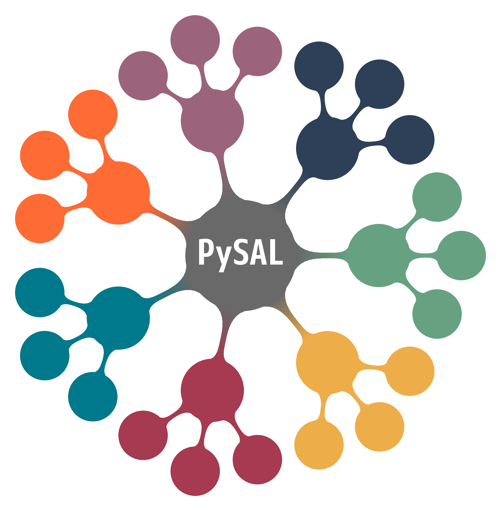

# workshop-pysal-narsc26

[](https://codespaces.new/knaaptime/workshop-pysal-narsc26)

Spatial Analysis and Econometrics with PySAL

North American Regional Science Council, Philadelphia, November 11, 2026

<p align="center">

</p>

### Instructors

* Eli Knaap - University of California, Irvine
* Serge Rey - San Diego State University

---

## Schedule

### Morning (9:00 to 12:00)

1. Spatial Data Analysis
   * geoprocessing and visualization (`00_geoprocessing`, `01_geovisualization`)
   * spatial graphs (`02_spatial_weights`, `03_weights_disparities`)
   * spatial autocorrelation (`04_spatial_autocorrelation`)

2. Spatial Segmentation
   * geodemographic analysis and regionalization (`05_geodemographic_analysis`)
   * segregation analysis (`06_segregation_analysis`)

### Afternoon (1:30 to 4:30)

3. Bayesian Spatial Econometrics with `neighbayes`
   * the logic of a Bayesian spatial regression (`07_bayesian_spatial_econometrics`)
   * OLS with spatial diagnostics; the spatial lag and spatial error models (`08_lag_and_error_models`)
   * break
   * the spatial Durbin and SLX models; direct and indirect effects (`09_durbin_models_and_effects`)
   * spatial probit, logit, and negative binomial models (`10_non_gaussian_outcomes`)
   * spatial panels (`11_spatial_panels`)

All notebooks live in `content/`.

## Getting Started

Clone the repository:

```bash
git clone https://github.com/knaaptime/workshop-pysal-narsc26.git
```

If you do not use git, download the materials as a zip file from the green Code button at <https://github.com/knaaptime/workshop-pysal-narsc26> and extract it to a working directory.

Then build the workshop environment by following the [installation instructions](docs/installation.md). The environment requires conda; a pip-only install will not work.

If your computer cannot build the environment (an Intel Mac, a Mac running macOS 14 or older, or a locked-down machine), open the materials in a browser instead with the Codespaces button at the top of this page. Codespaces runs the same environment on a GitHub server and needs only a free GitHub account.
